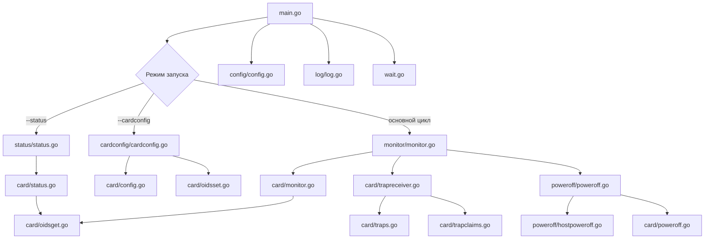

# Аудит проекта ups-agent

## 1. Общая информация

| Параметр | Значение |
|---|---|
| **Модуль** | `git.vsu.ru/ai/ups-agent` |
| **Версия Go** | 1.27.1 |
| **Назначение** | Агент мониторинга ИБП (UPS) по SNMP с функцией автоматического выключения хоста при сбое питания |
| **Поддерживаемые ОС** | Linux (основная), Windows (частичная) |
| **Модель ИБП** | СИПБ6КД.9-11/БПС (SNMP-карта на базе enterprise OID `.1.3.6.1.4.1.935`) |

## 2. Зависимости

| Зависимость | Версия | Назначение |
|---|---|---|
| [`github.com/gosnmp/gosnmp`](go.mod:6) | v1.45.0 | SNMP-клиент (GET/SET/Trap) |
| [`github.com/jinzhu/configor`](go.mod:7) | v1.2.2 | Загрузка YAML-конфигурации |
| [`gopkg.in/yaml.v3`](go.mod:8) | v3.0.1 | Маршалинг YAML (для `--configdump`) |
| [`github.com/BurntSushi/toml`](go.mod:11) | v1.6.0 | Транзитивная зависимость configor |

## 3. Архитектура

## 4. Структура пакетов

| Пакет | Файлы | Назначение |
|---|---|---|
| `main` | [`main.go`](main.go:11), [`wait.go`](wait.go:11) | Точка входа, обработка сигналов ОС |
| [`config`](config/config.go:1) | [`config.go`](config/config.go:1), [`internal.go`](config/internal.go:1) | Парсинг и валидация конфигурации |
| [`log`](log/log.go:1) | [`log.go`](log/log.go:1), [`utils.go`](log/utils.go:1), [`eol.go`](log/eol.go:1), [`eol_windows.go`](log/eol_windows.go:1) | Кастомный логгер с уровнями syslog |
| [`card`](card/oids.go:1) | [`oids.go`](card/oids.go:1), [`oidsget.go`](card/oidsget.go:1), [`oidsset.go`](card/oidsset.go:1), [`monitor.go`](card/monitor.go:1), [`status.go`](card/status.go:1), [`config.go`](card/config.go:1), [`traps.go`](card/traps.go:1), [`trapreceiver.go`](card/trapreceiver.go:1), [`trapclaims.go`](card/trapclaims.go:1), [`poweroff.go`](card/poweroff.go:1) | Взаимодействие с SNMP-картой ИБП |
| [`monitor`](monitor/monitor.go:1) | [`monitor.go`](monitor/monitor.go:1) | Основной цикл мониторинга |
| [`poweroff`](poweroff/poweroff.go:1) | [`poweroff.go`](poweroff/poweroff.go:1), [`hostpoweroff.go`](poweroff/hostpoweroff.go:1), [`hostpoweroff_windows.go`](poweroff/hostpoweroff_windows.go:1) | Логика выключения хоста и ИБП |
| [`status`](status/status.go:1) | [`status.go`](status/status.go:1), [`internal.go`](status/internal.go:1) | Вывод статуса ИБП |
| [`cardconfig`](cardconfig/cardconfig.go:1) | [`cardconfig.go`](cardconfig/cardconfig.go:1), [`internal.go`](cardconfig/internal.go:1) | Чтение/запись конфигурации SNMP-карты |

## 5. Поток выполнения (основной режим)

1. [`config.New()`](config/config.go:66) — загрузка и валидация [`ups-agent.yml`](ups-agent.yml:1)
2. [`log.New(conf)`](log/log.go:30) — инициализация логгера
3. [`go monitor.Run(conf, logger, trapc)`](monitor/monitor.go:13) — запуск основного цикла в горутине:
   - [`go card.TrapReceiver(...)`](card/trapreceiver.go:12) — приём SNMP-трапов
   - Бесконечный цикл: ожидание трапа или таймера опроса
   - При каждом срабатывании — [`card.Monitor()`](card/monitor.go:28) (SNMP GET)
   - Анализ статуса выхода ИБП и условий выключения
4. [`waitSignals(logger)`](wait.go:11) — ожидание сигналов (SIGHUP — переоткрытие лога, SIGINT/TERM/QUIT — выход)

## 6. Ключевые константы и OID

- **Enterprise OID**: `.1.3.6.1.4.1.935` (производитель ИБП)
- **Статусы выхода ИБП** ([`card/oids.go`](card/oids.go:61-71)): Online(2), OnBattery(3), Bypass(6), Sleep(5), и др.
- **Статусы АКБ** ([`card/oids.go`](card/oids.go:55-59)): Unknown(1), Ok(2), Low(3)
- **SNMP-трапы** ([`card/traps.go`](card/traps.go:10-72)): 53 зарегистрированных трапа, из них 9 с флагом `shutdown: true`

## 7. Выводы аудита

### 7.1. Сильные стороны

1. **Чёткая архитектура** — разделение на пакеты по зонам ответственности (SNMP, мониторинг, выключение, статус, конфигурация карты).
2. **Кроссплатформенность** — поддержка Linux и Windows через build-теги ([`poweroff/hostpoweroff.go`](poweroff/hostpoweroff.go:1), [`poweroff/hostpoweroff_windows.go`](poweroff/hostpoweroff_windows.go:1), [`log/eol.go`](log/eol.go:1), [`log/eol_windows.go`](log/eol_windows.go:1)).
3. **Безопасное выключение** — `sync.Once` в [`poweroff/poweroff.go`](poweroff/poweroff.go:38) предотвращает повторное выключение; тройной `syscall.Sync()` перед poweroff.
4. **Валидация конфигурации** — проверка IP-адреса, границ значений, наличия файла poweroff-команды ([`config/internal.go`](config/internal.go:56-89)).
5. **Переоткрытие лог-файла** — по SIGHUP для ротации логов ([`wait.go`](wait.go:17-19), [`log/log.go`](log/log.go:53-68)).
6. **Защита от переполнения канала трапов** — неблокирующая отправка с логированием dropped-трапов ([`card/trapreceiver.go`](card/trapreceiver.go:77-82)).
7. **ACL для трапов** — фильтрация по IP-адресу источника ([`card/trapreceiver.go`](card/trapreceiver.go:68-70)).
8. **Systemd-интеграция** — unit-файл с `AmbientCapabilities` ([`contrib/ups-agent.service`](contrib/ups-agent.service:16)), logrotate-конфиг ([`contrib/ups-agent.logrotate`](contrib/ups-agent.logrotate:1)).

### 7.2. Проблемы и рекомендации

#### 🔴 Критические

#### 🟡 Средние

3. **Дублирование форматирования в `status/internal.go` и `cardconfig/internal.go`** — функции `getSensitivity`, `getAlarm`, `getShutoffDelay`, `getReturnDelay`, `getLowBatteryRunTime`, `getMinReturnCapacity` реализованы в обоих пакетах идентично. **Рекомендация**: вынести общие форматтеры в пакет `card` или создать отдельный пакет `format`.

5. **Отсутствие unit-тестов** — в проекте нет ни одного тестового файла. **Рекомендация**: добавить тесты для критической логики (условия выключения, парсинг конфигурации, обработка трапов).

6. **`README.md`** содержит только одну строку про `loginctl enable-linger`. **Рекомендация**: дополнить документацией по установке, настройке и использованию.

#### 🟢 Низкие

8. **Неиспользуемая функция `getLevelString`** в [`log/utils.go`](log/utils.go:38) — объявлена, но нигде не вызывается. **Рекомендация**: удалить или использовать (например, в отладочном выводе).

10. **Жёстко заданные значения по умолчанию в [`cardconfig/cardconfig.go`](cardconfig/cardconfig.go:52-59)** — значения `setDefaultConfig` захардкожены. **Рекомендация**: вынести в константы или конфигурационный файл.

12. **Отсутствует `.gitignore`** в корне (файл есть, но пустой или минимальный). **Рекомендация**: добавить стандартные правила для Go-проекта.

### 7.3. Потенциальные race conditions

- Канал [`trapc`](main.go:27) используется одной горутиной-писателем ([`TrapReceiver`](card/trapreceiver.go:12)) и одним читателем ([`monitor.Run`](monitor/monitor.go:13)) — безопасно.
- [`poweroff.PowerOff.once`](poweroff/poweroff.go:15) (`sync.Once`) — потокобезопасно.

## 8. Итоговая оценка

| Категория | Оценка |
|---|---|
| Архитектура | ⭐⭐⭐⭐ |
| Качество кода | ⭐⭐⭐ |
| Безопасность | ⭐⭐⭐⭐ |
| Документация | ⭐ |
| Тестирование | ⭐ |
| Кроссплатформенность | ⭐⭐⭐⭐ |

**Общая оценка: 3.2 / 5**

Проект имеет зрелую архитектуру и решает конкретную производственную задачу. Основные направления для улучшения: покрытие тестами, документация, устранение дублирования кода и добавление безопасных type assertion.